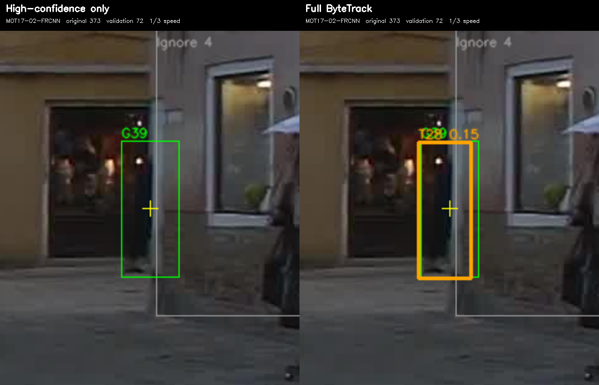
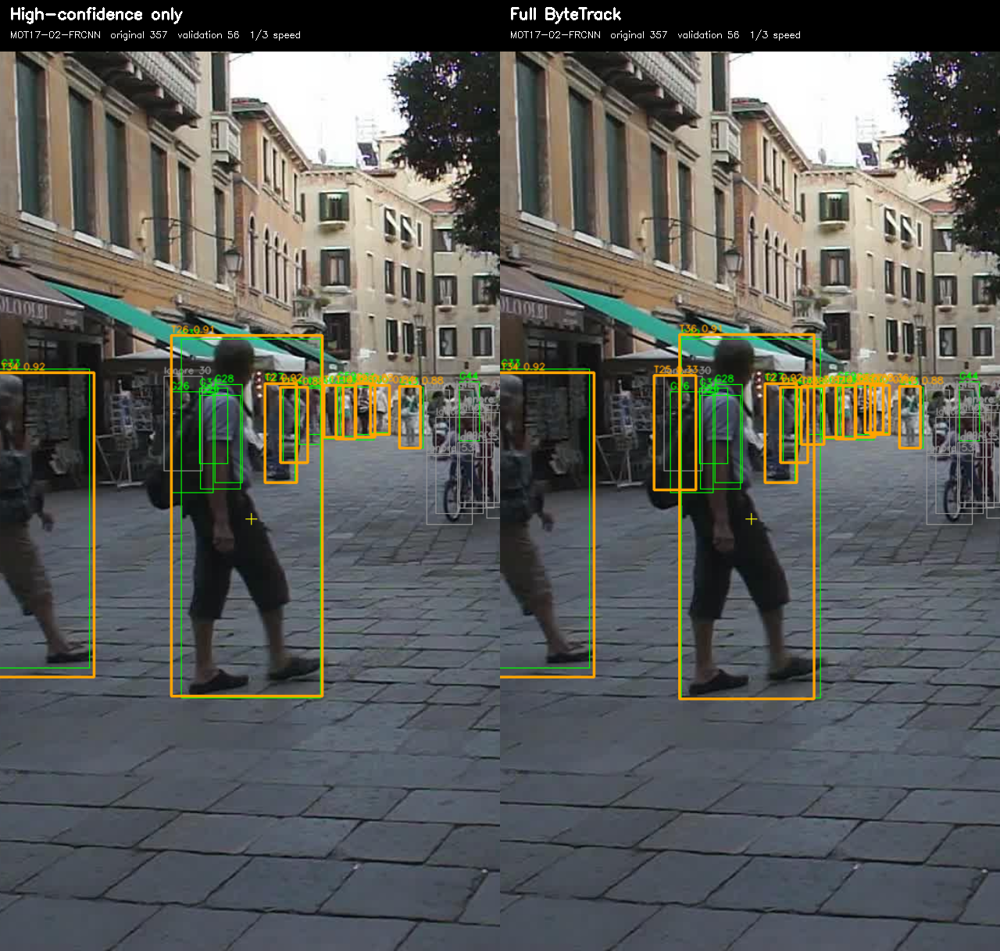

# 시각 사례

시각화는 동일한 원본 프레임에서 High-only를 왼쪽, Full ByteTrack을 오른쪽에 표시합니다. 전체 원본 영상이나 정답 주석 파일은 포함하지 않으며, 아래에 선택한 비교 클립과 키프레임을 제공합니다. 두 시각화 노트북은 사용자가 받은 MOT17 이미지와 자신의 결과 ZIP으로 사례를 생성합니다.

## 회복 사례

[비교 영상 보기](../assets/recovery/comparison.mp4) · [대표 프레임 373](../assets/recovery/frame_373.png)

- Sequence: MOT17-02-FRCNN.
- Original frames 369–376; representative frame 373.
- Scored ground-truth identity G39.
- Full ByteTrack retains T28; frame373 score0.15 and GT IoU about0.833.
- High-only has no close matching prediction on that pedestrian.

This illustrates retaining a useful low-confidence observation. It does not prove every long-term occlusion can be recovered.

## 국소적인 ID 연속성 문제

[비교 영상 보기](../assets/identity_change/comparison.mp4) · [프레임 350](../assets/identity_change/frame_350.png) · [프레임 357](../assets/identity_change/frame_357.png) · [프레임 365](../assets/identity_change/frame_365.png)

Same annotated pedestrian G32 in MOT17-02:

| Original frame | High-only | Full ByteTrack |
|---|---|---|
| 350 | T26 | T26 |
| 357 | T26 | T36 |
| 365 | T26 | T26 |

Saved best-overlap assignments show Full T26 through351, T36 at352–362, and T26 again from363. High-only retains T26 throughout348–367. The keyframes show the same foreground pedestrian carrying a backpack. This is a visual/coordinate continuity observation, not an independent replay identifying particular TrackEval IDSW events or the exact internal cause.

## 이전의 먼 사람 후보에 대한 주의

An earlier crop around MOT17-11 frame790 contained extra predictions without matching GT. Distant human figures are visible. This is not proof of a nonexistent-person detection. Missing annotations, reflections/depictions, or localization errors are possible explanations. Do not present that crop as an unambiguous background false positive.

## 미디어 출처와 재현

- Source images: [MOT17, MOT17-02-FRCNN](https://motchallenge.net/data/MOT17/), distributed by MOTChallenge. Original dataset imagery belongs to its respective creators; the ByteTrack MIT license does not cover dataset imagery.
- Changes to source imagery: cropped views, side-by-side layouts, bounding boxes, tracking IDs and explanatory overlays. The identity-change clip uses 10 fps playback for a 30 fps source, so it is slowed down for inspection; it is not a tracker speed benchmark.
- These six media files were copied byte-for-byte from the user's returned `ByteTrack_identity_change_example.zip`; no new tracking inference or image generation was performed for publication. File hashes and archive provenance are in [assets/manifest.json](../assets/manifest.json).
- Filenames in the returned identity-change archive include the candidate frame `original_357` in all three keyframe names. Published names use the actual frames from the notebook's selected-example record: validation 49/56/64 correspond to original 350/357/365.
- Generated with [Visual Examples](../notebooks/ByteTrack_Visual_Examples_Colab.ipynb) and [Identity Change](../notebooks/ByteTrack_Identity_Change_Example_Colab.ipynb), using the user's saved controlled-comparison outputs. The identity archive also contained earlier examples; only the two documented cases are selected here.
- Cite MOTChallenge and the ByteTrack authors when reusing these visualizations, and follow the original dataset's applicable use/distribution terms. These clips demonstrate observed behavior; they do not by themselves establish independent authorship or course-policy compliance.
